# Veltrix — Cloud-Native E-Commerce Application

<p align="center">
  <strong>A DevOps Capstone Project</strong><br>
  Automated CI/CD · Docker · Kubernetes · Prometheus · Grafana · Slack
</p>

<p align="center">
  
  
  
  
  
  
</p>

---

## Table of Contents

- [1. Overview](#1-overview)
- [2. What Is Veltrix?](#2-what-is-veltrix)
- [3. Why This Project?](#3-why-this-project)
- [4. Key Features](#4-key-features)
- [5. Technology Stack](#5-technology-stack)
- [6. Architecture](#6-architecture)
- [7. Application Screenshots](#7-application-screenshots)
- [8. How CI/CD Works](#8-how-cicd-works)
- [9. Docker Containerization](#9-docker-containerization)
- [10. Kubernetes Deployment](#10-kubernetes-deployment)
- [11. Monitoring with Prometheus and Grafana](#11-monitoring-with-prometheus-and-grafana)
- [12. Horizontal Pod Autoscaling](#12-horizontal-pod-autoscaling)
- [13. Slack Notifications](#13-slack-notifications)
- [14. Project Structure](#14-project-structure)
- [15. Prerequisites](#15-prerequisites)
- [16. Run Locally](#16-run-locally)
- [17. Run with Docker](#17-run-with-docker)
- [18. Kubernetes Commands](#18-kubernetes-commands)
- [19. CI/CD Configuration](#19-cicd-configuration)
- [20. Testing and Validation](#20-testing-and-validation)
- [21. Challenges and Solutions](#21-challenges-and-solutions)
- [22. Future Enhancements](#22-future-enhancements)
- [23. Author](#23-author)

---

## 1. Overview

**Veltrix** is a cloud-native e-commerce demonstration application built with Flask and supported by a DevOps automation pipeline.

The project demonstrates how an application can be containerised, published to Docker Hub, deployed to Kubernetes, monitored using Prometheus and Grafana, and scaled automatically based on CPU utilisation.

GitHub Actions automates the Continuous Integration and Continuous Deployment (CI/CD) process, while Slack notifications provide visibility into pipeline results.

The primary objective is to demonstrate a practical DevOps workflow, from source-code changes to application deployment and operational monitoring.

## 2. What Is Veltrix?

Veltrix combines a lightweight e-commerce web application with an automated infrastructure and deployment workflow.

The application provides a product catalogue and shopping interface. The DevOps environment manages its packaging, delivery, orchestration, monitoring, and scaling.

The current application is a demonstration project and does not represent a production payment-processing or database-backed commerce platform.

### Veltrix at a glance

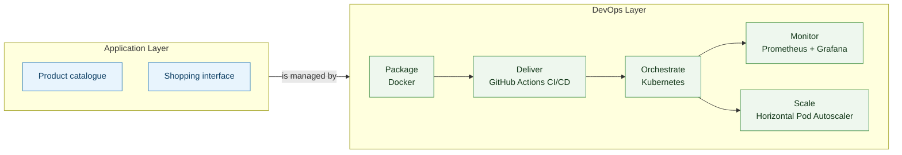

## 3. Why This Project?

Modern applications require more than working source code. They also need reliable deployment processes, repeatable environments, operational visibility, and the ability to respond to changing workloads.

Veltrix was developed to demonstrate these practices in one project.

The project addresses the following questions:

- **What happens when application code changes?** GitHub Actions automatically starts the CI/CD workflow after a push to the `main` branch.
- **Why use Docker?** Docker packages the application and its dependencies into a portable image.
- **Why use Kubernetes?** Kubernetes manages application pods, deployment updates, service discovery, and horizontal scaling.
- **Why use monitoring?** Prometheus collects metrics, while Grafana presents them in dashboards.
- **Why use autoscaling?** Horizontal Pod Autoscaling can adjust the number of application replicas based on CPU utilisation.
- **Why use Slack notifications?** Notifications provide a convenient way to communicate deployment outcomes.

### Each question and the tool that answers it

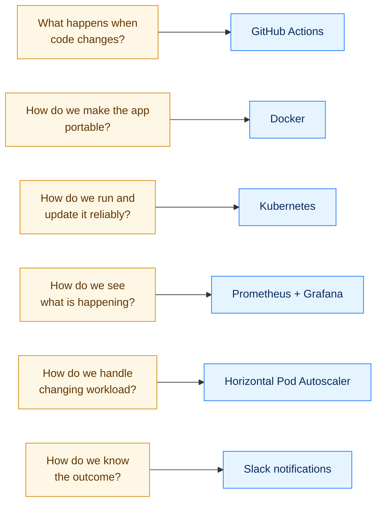

## 4. Key Features

| Feature | Description |
|---|---|
| E-commerce interface | Flask-based product catalogue and shopping interface |
| Python validation | Checks Python syntax during CI |
| Docker image build | Packages the application into a container image |
| Docker Hub publishing | Publishes versioned images to a remote registry |
| Automated deployment | Updates the Kubernetes deployment after successful CI |
| Kubernetes orchestration | Manages application pods and service access |
| Horizontal Pod Autoscaling | Scales replicas according to CPU utilisation |
| Prometheus monitoring | Collects application and Kubernetes metrics |
| Grafana dashboards | Visualises resource usage and workload metrics |
| Slack notifications | Communicates CI/CD results |
| Git-based versioning | Associates deployed images with Git commit identifiers |

## 5. Technology Stack

| Technology | Purpose |
|---|---|
| Python 3.12 | Application runtime and CI syntax validation |
| Flask | Web application framework |
| HTML, CSS and JavaScript | User interface |
| Git and GitHub | Source-code management |
| GitHub Actions | CI/CD automation |
| Docker | Containerisation |
| Docker Hub | Container image registry |
| Kubernetes | Application orchestration |
| kind | Local Kubernetes cluster |
| Metrics Server | CPU and memory metrics for Kubernetes resource monitoring and HPA |
| Prometheus | Metrics collection |
| Grafana | Monitoring dashboards |
| Helm | Installation and management of the monitoring stack |
| Slack | CI/CD notifications |
| PowerShell | Windows deployment-runner commands |

### Technology stack by layer

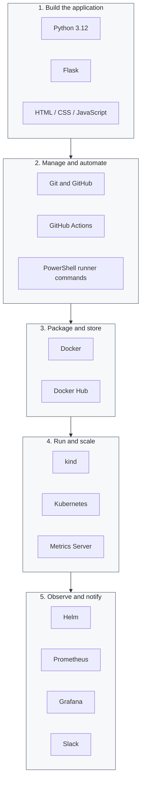

## 6. Architecture

The project follows a CI/CD workflow that connects source-code management, container image publishing, Kubernetes deployment, monitoring, and notifications.

### High-level architecture

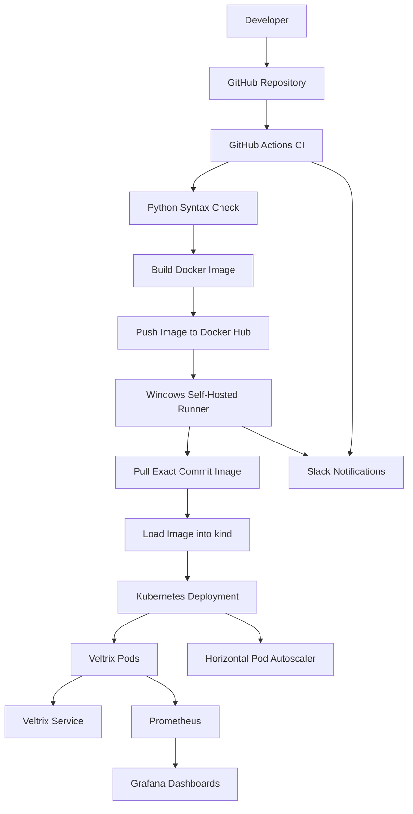

### Architecture explanation

1. The developer pushes changes to the `main` branch.
2. GitHub Actions checks out the source code and validates the Python application.
3. Docker builds the application image.
4. The image is pushed to Docker Hub with version tags, including the commit SHA.
5. The Windows self-hosted runner pulls the exact image produced by CI.
6. The image is loaded into the local kind cluster.
7. Kubernetes updates the Veltrix deployment and checks rollout status.
8. Prometheus and Grafana provide monitoring and visualisation.
9. HPA adjusts the number of replicas based on configured resource targets.
10. Slack communicates the pipeline outcome.

### Where each component runs

The pipeline spans two environments: cloud services (GitHub and Docker Hub) and the local Windows machine that hosts the self-hosted runner and the kind cluster.

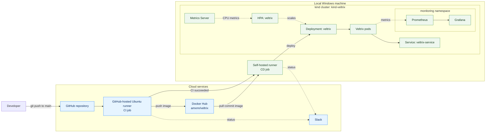

## 7. Application Screenshots

The following screenshots are stored in the repository's `veltrix-screenshots/` directory. GitHub renders these images in the README preview.

### 7.1 Application interface

#### Application screenshot 1

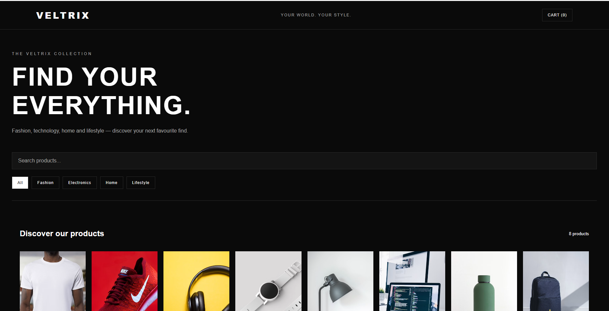

#### Application screenshot 2

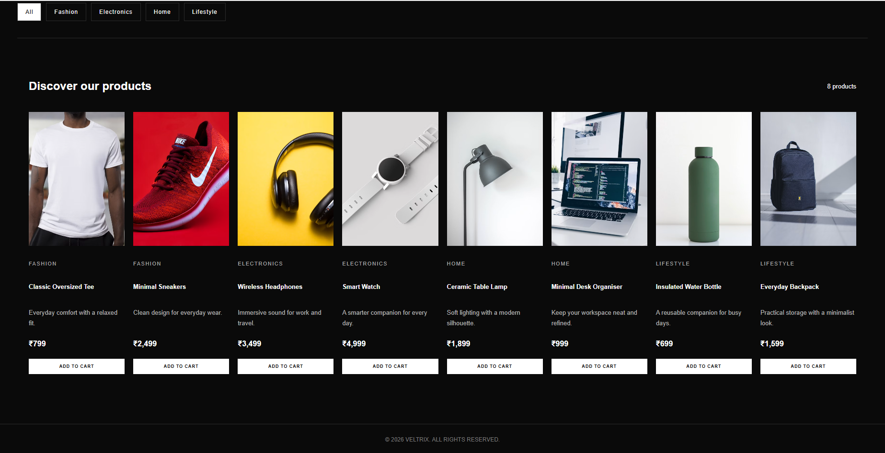

#### Application screenshot 3

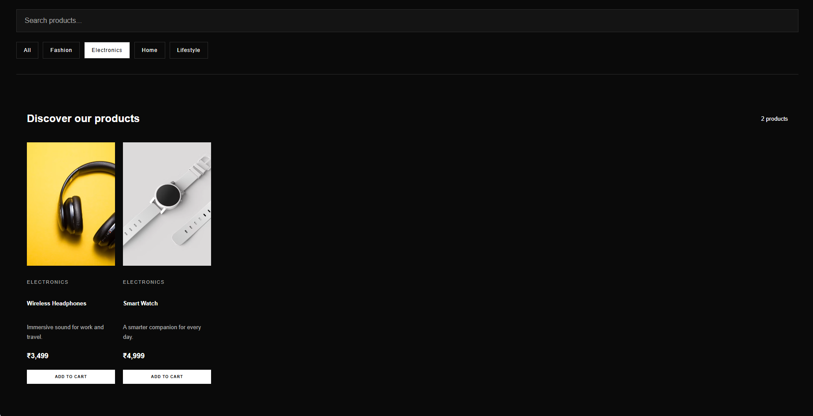

#### Application screenshot 4

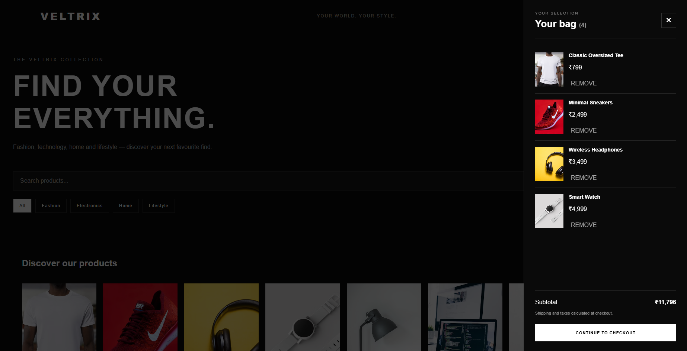

#### Application screenshot 5

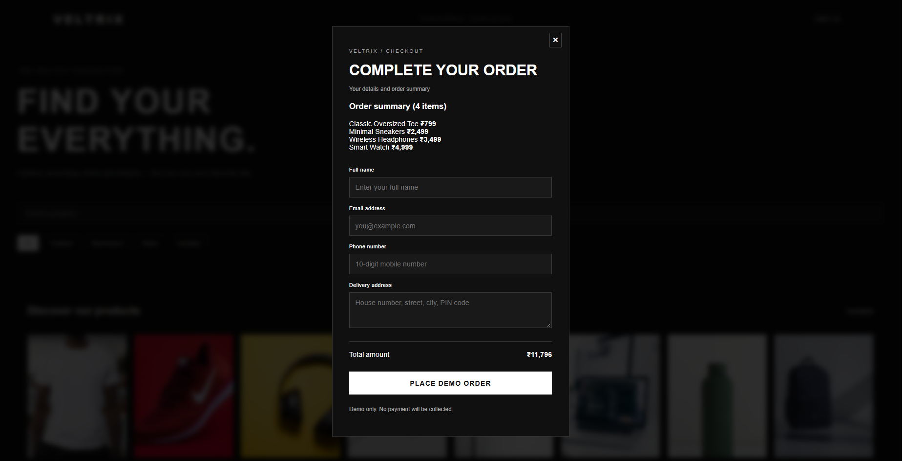

#### Application screenshot 6

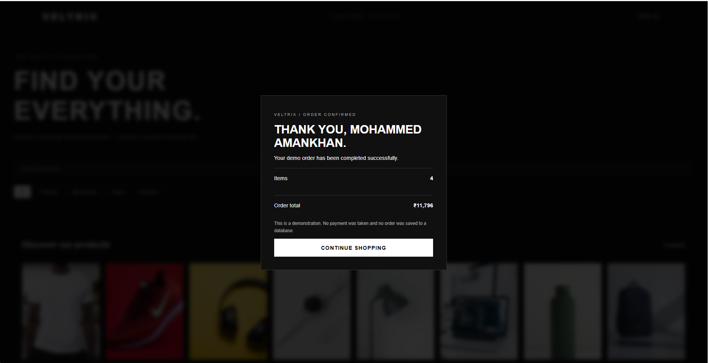

### 7.2 CI/CD workflow

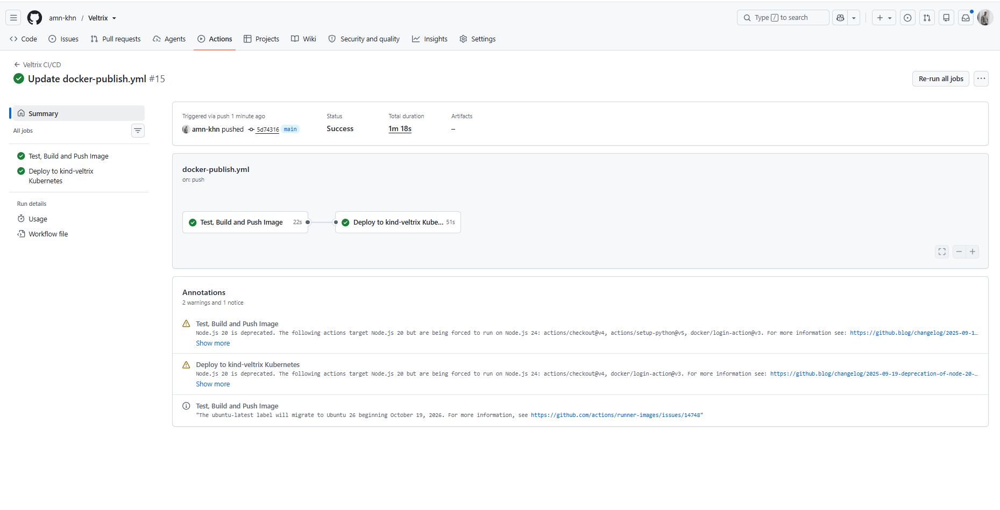

### 7.3 Docker and Kubernetes environment

#### Docker Desktop Kubernetes cluster

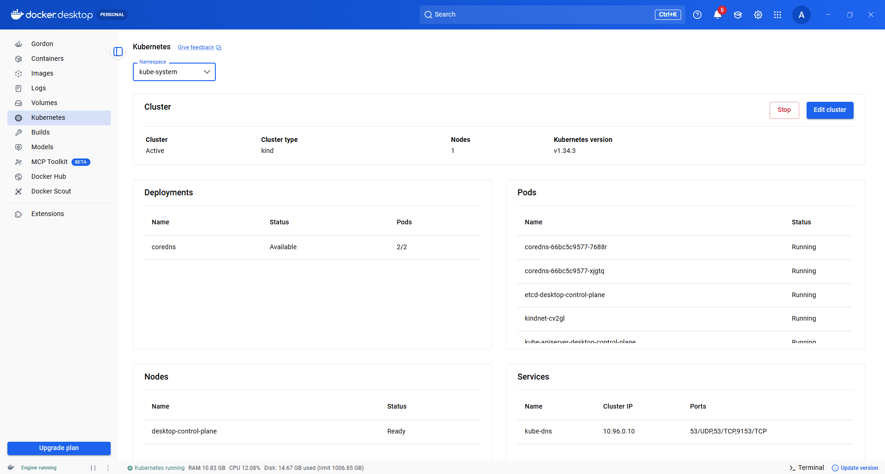

#### Docker Desktop container view

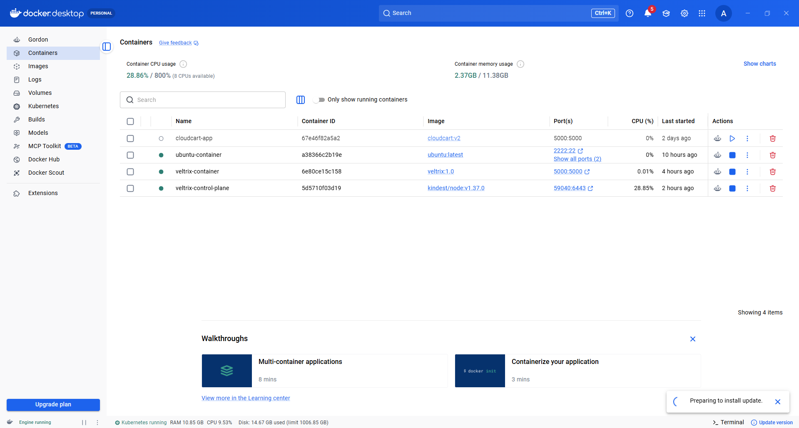

### 7.4 Docker Hub repository

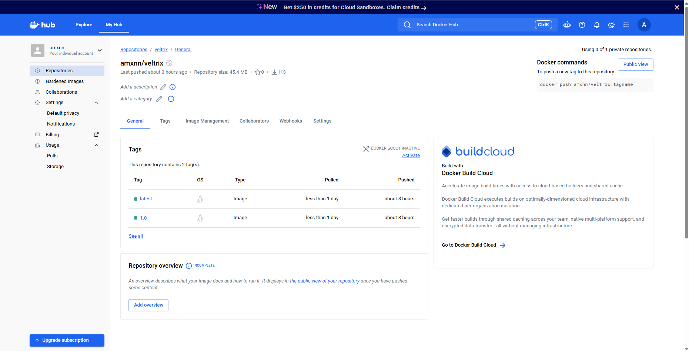

### 7.5 Kubernetes autoscaling

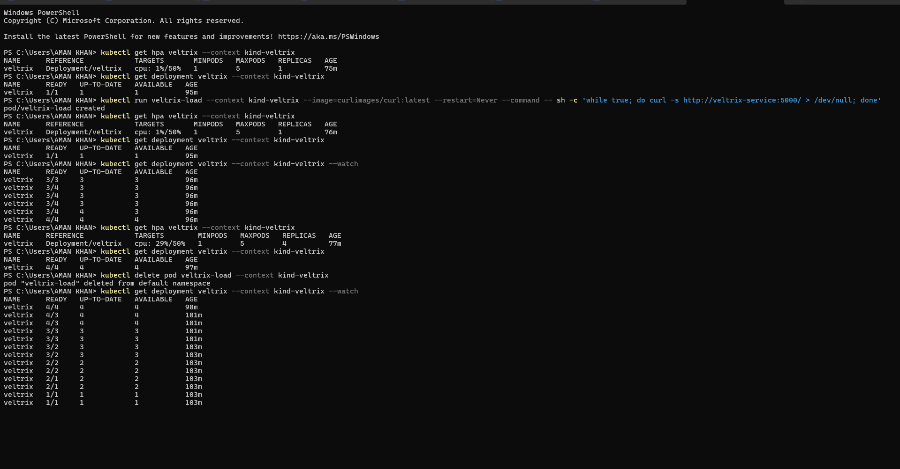

### 7.6 Monitoring dashboards

#### Grafana

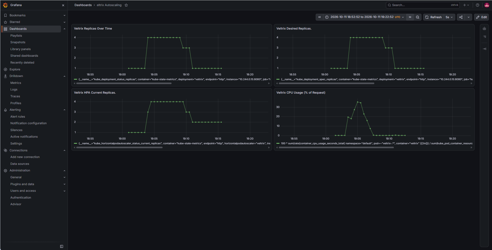

#### Prometheus

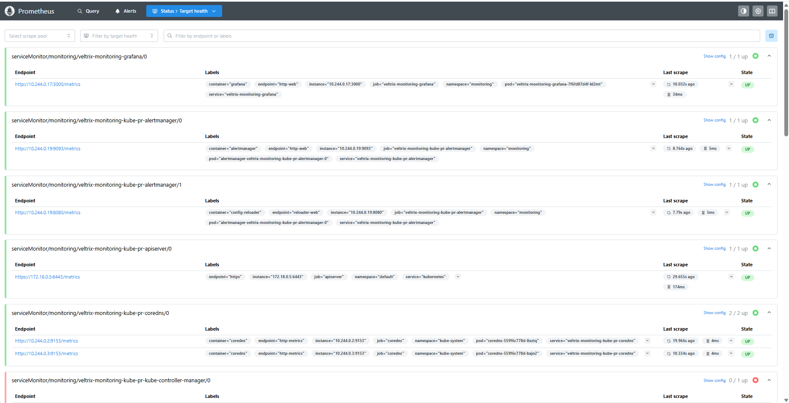

### 7.7 Slack notifications

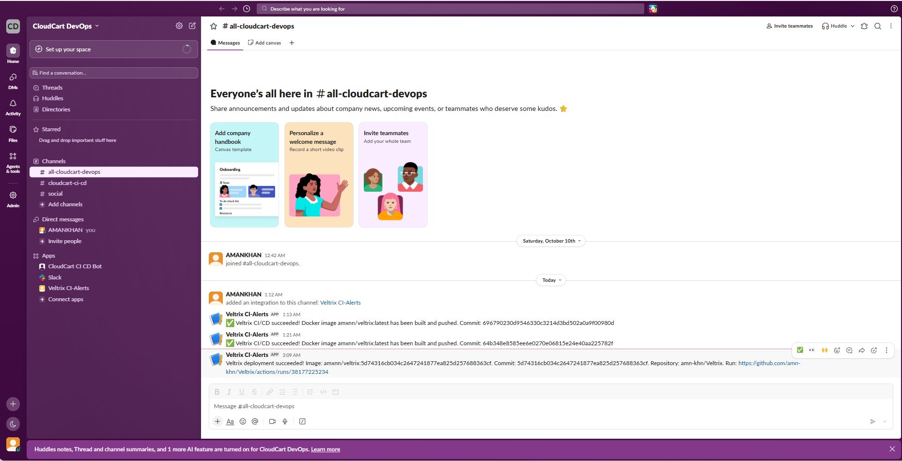

### 7.8 Workflow evidence

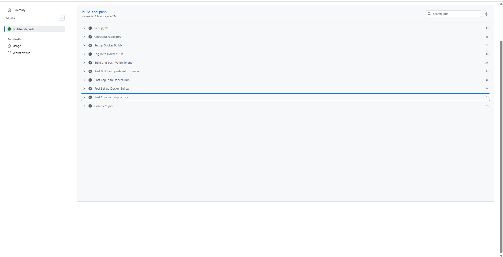

> **Note:** The Docker Desktop screenshots document the environment shown in those captures. The current automated deployment workflow targets the `kind-veltrix` cluster, so the screenshots should be interpreted according to the environment and date in which they were captured.

## 8. How CI/CD Works

Veltrix uses GitHub Actions to automate the journey from a source-code change to a Kubernetes deployment.

### Continuous Integration (CI)

The CI job runs on GitHub-hosted Ubuntu infrastructure.

It performs the following operations:

1. Checks out the repository.
2. Sets up Python 3.12.
3. Installs dependencies from `requirements.txt`.
4. Validates Python syntax using `py_compile`.
5. Builds the Docker image.
6. Authenticates with Docker Hub for pushes to `main`.
7. Publishes the image using version tags and the commit SHA.

### Continuous Deployment (CD)

The CD job runs on a Windows self-hosted runner with access to the local Kubernetes cluster.

It performs the following operations:

1. Verifies the required command-line tools.
2. Checks access to the `kind-veltrix` cluster.
3. Verifies the existing Veltrix deployment and service.
4. Authenticates with Docker Hub.
5. Pulls the image corresponding to the current Git commit.
6. Loads the image into the kind cluster.
7. Updates the image used by the Kubernetes deployment.
8. Waits for the rollout to complete.
9. Verifies the deployment, pods, service, and HPA.

The CD job runs only after the CI job succeeds and only for pushes to `main`.

### CI vs CD at a glance

```mermaid
flowchart LR
    subgraph CI["CI job — GitHub-hosted Ubuntu runner"]
        direction LR
        C1["Checkout"] --> C2["Set up<br/>Python 3.12"] --> C3["Install<br/>requirements"] --> C4["Syntax check<br/>py_compile"] --> C5["Build Docker<br/>image"] --> C6["Docker Hub<br/>login"] --> C7["Push tags"]
    end

    GATE{{"CI succeeded<br/>and push to main?"}}

    subgraph CD["CD job — Windows self-hosted runner"]
        direction LR
        D1["Verify tools"] --> D2["Check<br/>kind-veltrix"] --> D3["Verify deployment<br/>and service"] --> D4["Docker Hub<br/>login"] --> D5["Pull commit<br/>image"] --> D6["Load into<br/>kind"] --> D7["Update<br/>deployment"] --> D8["Wait for<br/>rollout"] --> D9["Verify pods,<br/>service, HPA"]
    end

    CI --> GATE -->|"yes"| CD

    classDef ci fill:#e6f4ff,stroke:#1677ff,color:#0a2a5c;
    classDef cd fill:#eef7ee,stroke:#3c8d40,color:#14391a;
    classDef gate fill:#fff7e6,stroke:#d48806,color:#613400;
    class C1,C2,C3,C4,C5,C6,C7 ci;
    class D1,D2,D3,D4,D5,D6,D7,D8,D9 cd;
    class GATE gate;
```

### CI/CD sequence

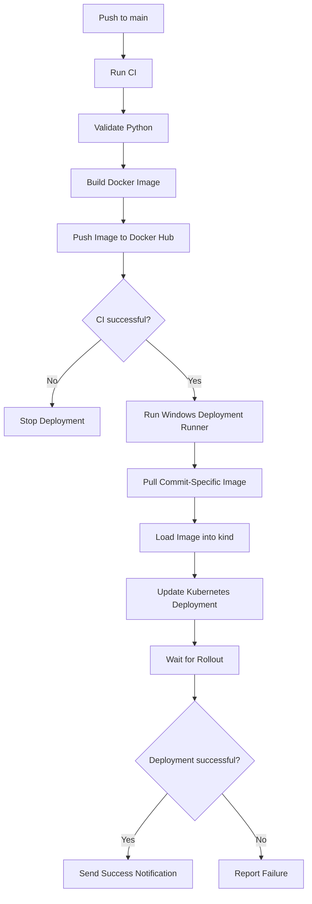

### Who talks to whom

This sequence diagram shows the order of interactions between the systems involved in a single deployment.

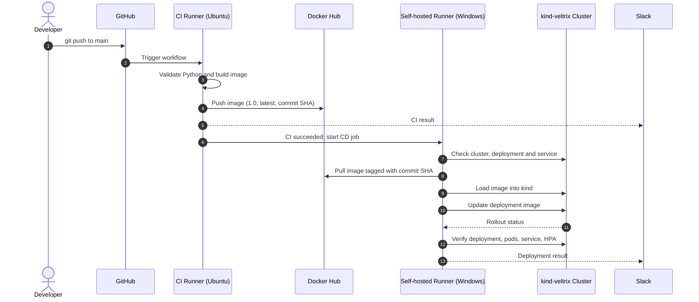

### Why use commit-specific image tags?

A Git commit SHA identifies the source revision used to build an image.

For example:

```text
amxnn/veltrix:<git-commit-sha>
```

The pipeline uses this identifier to deploy the image produced by that particular CI run instead of relying only on a mutable tag such as `latest`.

### How one commit becomes one deployed image

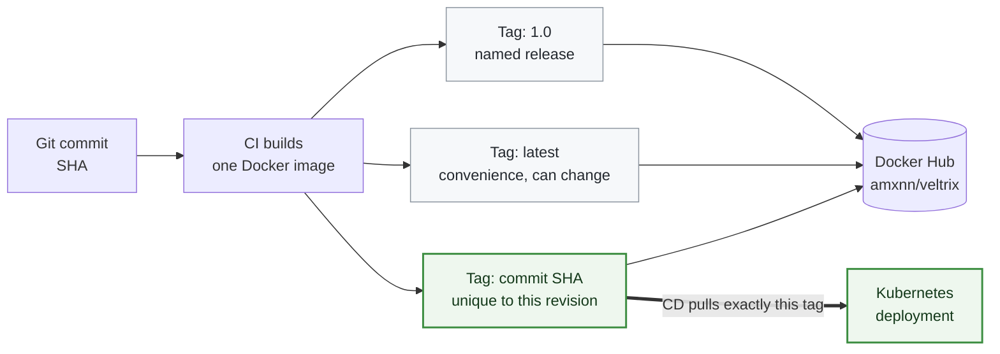

## 9. Docker Containerization

Docker packages the Veltrix application and its runtime dependencies into an image.

The image is published to Docker Hub:

**Repository:** [amxnn/veltrix](https://hub.docker.com/r/amxnn/veltrix)

The workflow publishes these tags:

| Tag | Purpose |
|---|---|
| `1.0` | Named release tag |
| `latest` | Convenience tag for the most recently published image |
| Git commit SHA | Identifies the image associated with a specific revision |

### Build locally

```powershell
docker build -t veltrix:1.0 .
```

### Run locally

```powershell
docker run --rm -p 5000:5000 veltrix:1.0
```

Open the application at `http://127.0.0.1:5000` if the container listens on port 5000.

### From source code to running container

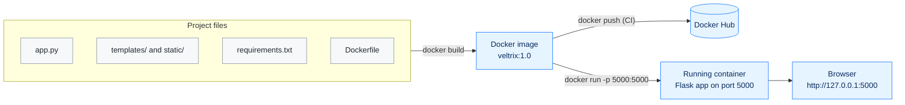

## 10. Kubernetes Deployment

Veltrix is deployed to a local Kubernetes cluster created using kind.

### Kubernetes resources

| Resource | Name | Responsibility |
|---|---|---|
| Deployment | `veltrix` | Manages application replicas and updates |
| Service | `veltrix-service` | Provides stable access to application pods |
| HPA | `veltrix` | Adjusts replica count based on configured metrics |
| Application pods | Generated by Deployment | Run the containerised Flask application |

### Why Kubernetes?

Kubernetes provides a consistent way to manage containers and supports rolling deployment updates, service discovery, replica management, and resource-based autoscaling.

### Verify the cluster

```powershell
kubectl --context kind-veltrix get nodes
```

### Inspect the deployment

```powershell
kubectl --context kind-veltrix get deployment veltrix
```

### Inspect pods and services

```powershell
kubectl --context kind-veltrix get pods
kubectl --context kind-veltrix get service veltrix-service
```

### Access the application

```powershell
kubectl --context kind-veltrix port-forward service/veltrix-service 8080:5000
```

Open `http://127.0.0.1:8080` while the port-forward command is running.

### How the Kubernetes resources fit together

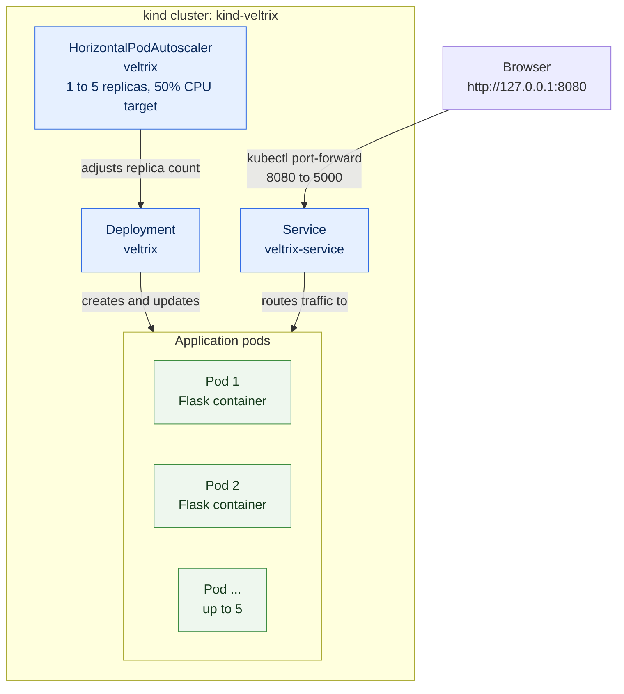

### What happens during a rolling update

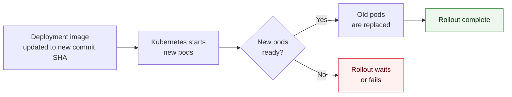

## 11. Monitoring with Prometheus and Grafana

Monitoring provides visibility into cluster health, pod behaviour, and resource consumption.

### Prometheus

Prometheus collects time-series metrics from supported Kubernetes and application-related targets.

The project uses metrics to observe deployment replica counts, pod information, and container resource usage.

### Grafana

Grafana provides dashboards for viewing the metrics collected by Prometheus.

The monitoring setup includes Kubernetes resource dashboards and a custom Veltrix autoscaling dashboard.

### Metrics Server

Metrics Server supplies resource metrics such as CPU and memory usage to Kubernetes. These metrics support commands such as `kubectl top` and the resource metrics API used by HPA.

Prometheus and Grafana provide monitoring and visualisation; Metrics Server supplies the CPU resource metrics used by the configured HPA.

### Useful commands

```powershell
kubectl --context kind-veltrix top nodes
kubectl --context kind-veltrix top pods
kubectl --context kind-veltrix get pods -n monitoring
```

Monitoring screenshots are available in the [Grafana](veltrix-screenshots/grafana.png) and [Prometheus](veltrix-screenshots/prometheus.png) sections above.

### Two metric paths, two purposes

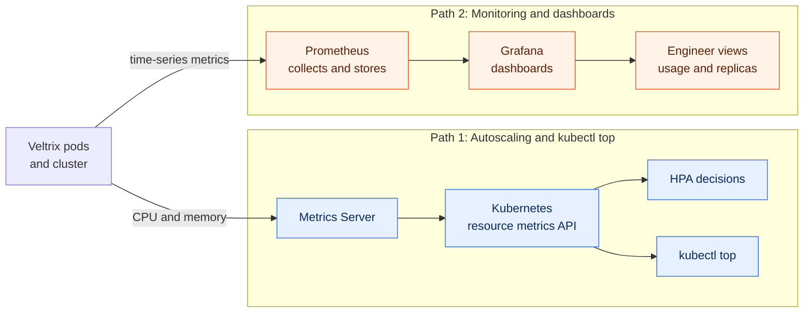

## 12. Horizontal Pod Autoscaling

Horizontal Pod Autoscaler (HPA) adjusts the number of pod replicas based on configured metrics and resource targets.

For this project, HPA is configured for the Veltrix deployment, with a target CPU utilisation of 50% and a replica range of 1 to 5.

### Inspect autoscaling

```powershell
kubectl --context kind-veltrix get hpa veltrix
```

### Observe resource consumption

```powershell
kubectl --context kind-veltrix top pods
```

### Observe deployment replicas

```powershell
kubectl --context kind-veltrix get deployment veltrix -w
```

The expected behaviour is for Kubernetes to increase replicas when sustained CPU utilisation exceeds the configured target and reduce them when demand falls, subject to metrics availability, scaling policies, and cooldown behaviour.

The HPA screenshot is available at [veltrix-screenshots/hpa.png](veltrix-screenshots/hpa.png).

### The autoscaling control loop

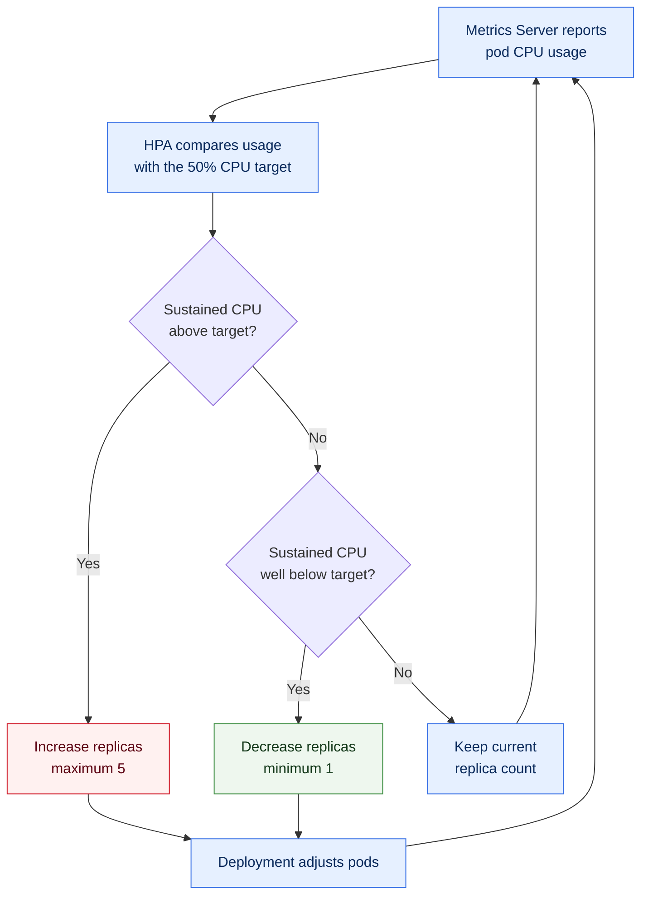

### Replica range

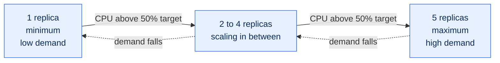

## 13. Slack Notifications

Slack notifications provide visibility into the outcome of the CI/CD process.

The workflow uses a GitHub Actions secret named `SLACK_WEBHOOK_URL` to deliver notifications without hardcoding the webhook URL in the repository.

Notifications can include:

- CI/CD status
- Commit identifier
- Docker image reference
- GitHub Actions run link

The webhook must be configured in GitHub repository secrets before notifications can work.


### How a notification reaches Slack

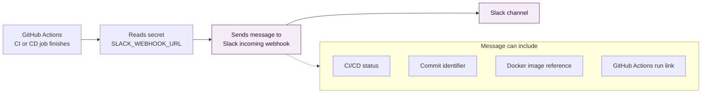

## 14. Project Structure

```text
Veltrix/
├── .github/
│   └── workflows/
│       └── docker-publish.yml
├── static/
│   ├── css/
│   │   └── style.css
│   └── js/
│       └── store.js
├── templates/
│   └── index.html
├── veltrix-screenshots/
│   ├── app-01.png
│   ├── app-02.png
│   ├── app-03.png
│   ├── app-04.png
│   ├── app-05.png
│   ├── app-06.png
│   ├── ci-cd.png
│   ├── docker-desktop-cluster.png
│   ├── docker-desktop-container.png
│   ├── dockerhub-repo.png
│   ├── grafana.png
│   ├── hpa.png
│   ├── prometheus.png
│   ├── slack.png
│   └── workflow.png
├── .gitignore
├── Dockerfile
├── app.py
├── requirements.txt
└── README.md
```

### What each part of the project does

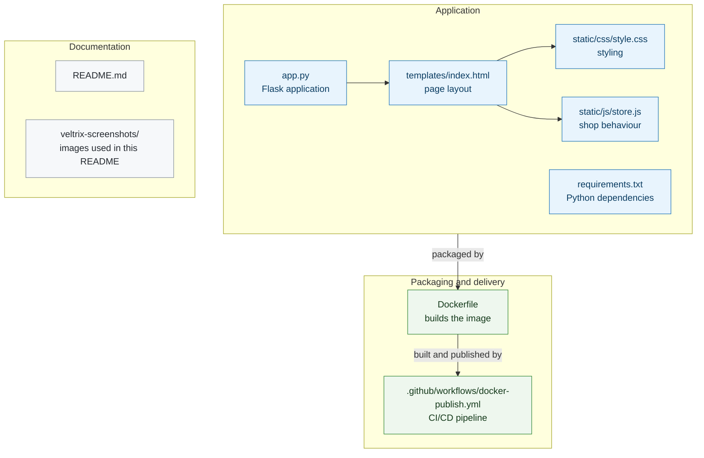

## 15. Prerequisites

To run the full development and deployment workflow, you need:

- Python 3.12 for CI compatibility
- Docker Desktop
- Git
- GitHub repository access
- Docker Hub account and repository
- kind
- kubectl
- A configured Windows self-hosted GitHub Actions runner
- A running `kind-veltrix` cluster
- Prometheus and Grafana installed if you want monitoring dashboards
- Metrics Server configured if you want resource-based HPA

The self-hosted runner must have access to Docker, kind, kubectl, and the correct Kubernetes context.

### Which prerequisites you need for each goal

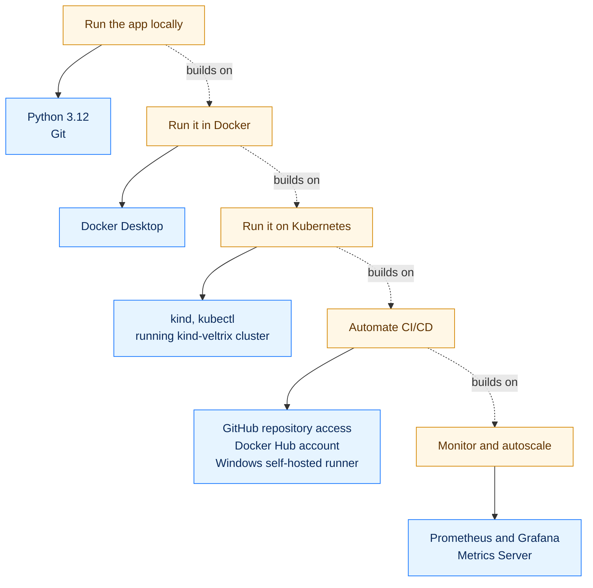

## 16. Run Locally

Clone the repository:

```powershell
git clone https://github.com/amn-khn/Veltrix.git
cd Veltrix
```

Create a virtual environment:

```powershell
python -m venv .venv
```

Activate it:

```powershell
.\.venv\Scripts\Activate.ps1
```

Install dependencies:

```powershell
python -m pip install --upgrade pip
pip install -r requirements.txt
```

Run the application:

```powershell
python app.py
```

Open the local URL displayed by Flask in the terminal.

### Local setup steps

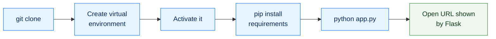

## 17. Run with Docker

Build the image:

```powershell
docker build -t veltrix:1.0 .
```

Run the container:

```powershell
docker run --rm -p 5000:5000 veltrix:1.0
```

Check running containers:

```powershell
docker ps
```

Stop the container with `Ctrl+C` if it is running in the foreground.

### Docker run workflow

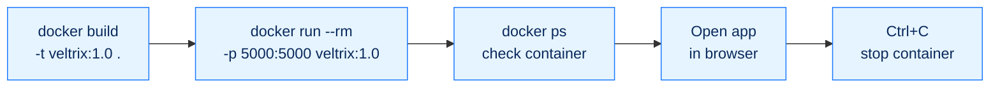

## 18. Kubernetes Commands

### View resources

```powershell
kubectl --context kind-veltrix get all
kubectl --context kind-veltrix get pods
kubectl --context kind-veltrix get deployments
kubectl --context kind-veltrix get services
```

### Inspect deployment details

```powershell
kubectl --context kind-veltrix describe deployment veltrix
```

### View application logs

```powershell
kubectl --context kind-veltrix logs deployment/veltrix
```

### Check rollout history

```powershell
kubectl --context kind-veltrix rollout history deployment/veltrix
```

### Restart the deployment manually

```powershell
kubectl --context kind-veltrix rollout restart deployment/veltrix
```

### Monitor HPA

```powershell
kubectl --context kind-veltrix get hpa veltrix --watch
```

### Which command to use for which question

```mermaid
flowchart LR
    Q1{"What do you<br/>want to know?"}
    Q1 --> A1["What is running?"] --> C1["get all, get pods,<br/>get deployments, get services"]
    Q1 --> A2["Why is it behaving<br/>this way?"] --> C2["describe deployment veltrix"]
    Q1 --> A3["What is the app<br/>printing?"] --> C3["logs deployment/veltrix"]
    Q1 --> A4["What changed<br/>over time?"] --> C4["rollout history<br/>deployment/veltrix"]
    Q1 --> A5["Need a fresh<br/>start?"] --> C5["rollout restart<br/>deployment/veltrix"]
    Q1 --> A6["Is it scaling?"] --> C6["get hpa veltrix --watch"]

    classDef q fill:#fff7e6,stroke:#d48806,color:#613400;
    classDef a fill:#f6f8fa,stroke:#8c959f,color:#24292f;
    classDef c fill:#e6f0ff,stroke:#326ce5,color:#0a2a5c;
    class Q1 q;
    class A1,A2,A3,A4,A5,A6 a;
    class C1,C2,C3,C4,C5,C6 c;
```

## 19. CI/CD Configuration

The workflow is located at:

```text
.github/workflows/docker-publish.yml
```

### Required GitHub Actions secrets

| Secret | Purpose |
|---|---|
| `DOCKERHUB_USERNAME` | Docker Hub account username |
| `DOCKERHUB_PASSWORD` | Credential used by the workflow to authenticate to Docker Hub |
| `SLACK_WEBHOOK_URL` | Slack incoming webhook URL |

Use a Docker Hub access token as the credential if Docker Hub rejects normal password authentication.

### Trigger behaviour

| Event | CI | CD |
|---|---|---|
| Push to `main` | Runs and publishes image | Runs after CI succeeds |
| Pull request to `main` | Runs validation and image build | Does not deploy |
| Manual dispatch | Depends on workflow trigger configuration | Requires the deployment condition to permit it |

The current workflow's deployment condition is specifically restricted to pushes to `main`.

### Trigger decision flow

```mermaid
flowchart TD
    E["GitHub event"] --> T{"Which event?"}
    T -->|"Push to main"| P1["CI runs<br/>validate, build, publish image"]
    P1 --> P2{"CI succeeded?"}
    P2 -- Yes --> P3["CD runs<br/>deploys to kind-veltrix"]
    P2 -- No --> P4["No deployment"]
    T -->|"Pull request to main"| PR["CI runs<br/>validate and build only"]
    PR --> PR2["CD does not deploy"]
    T -->|"Manual dispatch"| M["Depends on workflow<br/>trigger configuration"]
    M --> M2["CD only if deployment<br/>condition permits"]

    classDef ok fill:#eef7ee,stroke:#3c8d40,color:#14391a;
    classDef stop fill:#fff1f0,stroke:#cf1322,color:#5c0011;
    classDef info fill:#e6f4ff,stroke:#1677ff,color:#0a2a5c;
    class P3 ok;
    class P4,PR2 stop;
    class P1,PR,M,M2 info;
```

### Where each secret is used

```mermaid
flowchart LR
    S1["DOCKERHUB_USERNAME"] --> U1["Docker Hub login<br/>CI push and CD pull"]
    S2["DOCKERHUB_PASSWORD<br/>or access token"] --> U1
    S3["SLACK_WEBHOOK_URL"] --> U2["Slack notifications"]

    classDef sec fill:#fff7e6,stroke:#d48806,color:#613400;
    classDef use fill:#e6f4ff,stroke:#1677ff,color:#0a2a5c;
    class S1,S2,S3 sec;
    class U1,U2 use;
```

## 20. Testing and Validation

The project can be validated through the following checks.

| Area | Validation |
|---|---|
| Python | `python -m py_compile app.py` |
| Docker | Build the image successfully |
| Docker Hub | Confirm the expected image tags are published |
| Kubernetes | Confirm the deployment rollout succeeds |
| Pods | Confirm pods become ready |
| Service | Confirm the service exists and forwards traffic |
| HPA | Confirm metrics are available and the autoscaler reports a target |
| Monitoring | Confirm Prometheus targets and Grafana dashboards |
| Slack | Confirm the webhook receives the workflow result |

A successful CI run alone does not prove that CD has succeeded. The deployment job and application availability should also be verified.

### Validation checklist as a pipeline

```mermaid
flowchart LR
    V1["Python<br/>py_compile"] --> V2["Docker<br/>image builds"] --> V3["Docker Hub<br/>tags published"] --> V4["Kubernetes<br/>rollout succeeds"] --> V5["Pods<br/>ready"] --> V6["Service<br/>forwards traffic"] --> V7["HPA<br/>reports target"] --> V8["Prometheus and<br/>Grafana show data"] --> V9["Slack receives<br/>result"]

    subgraph CIV["Confirmed by CI"]
        V1
        V2
        V3
    end
    subgraph CDV["Confirmed by CD and manual checks"]
        V4
        V5
        V6
        V7
    end
    subgraph OBS["Operational visibility"]
        V8
        V9
    end

    classDef ci fill:#e6f4ff,stroke:#1677ff,color:#0a2a5c;
    classDef cd fill:#eef7ee,stroke:#3c8d40,color:#14391a;
    classDef obs fill:#fff3e8,stroke:#e6522c,color:#5c1f0a;
    class V1,V2,V3 ci;
    class V4,V5,V6,V7 cd;
    class V8,V9 obs;
```

## 21. Challenges and Solutions

### Image availability across runners

**Challenge:** The CI job builds the image on a GitHub-hosted runner, while CD runs on a separate Windows machine.

**Solution:** Publish the image to Docker Hub, then pull the exact commit-tagged image on the deployment runner before loading it into kind.

### Docker Hub authentication

**Challenge:** Incorrect credentials prevent image publishing or pulling.

**Solution:** Configure the required GitHub secrets and verify that the credential works for automated Docker Hub authentication.

### Local Kubernetes access

**Challenge:** A self-hosted runner must have access to the intended cluster and Kubernetes context.

**Solution:** Verify `kind-veltrix` before running deployment commands and keep the local cluster available during CD.

### Resource-based autoscaling

**Challenge:** HPA requires resource metrics to calculate CPU utilisation.

**Solution:** Install and configure Metrics Server, define CPU resource requests, and verify metrics with `kubectl top`.

### Monitoring visibility

**Challenge:** Application deployment status alone does not show resource consumption or workload behaviour.

**Solution:** Use Prometheus to collect metrics and Grafana to visualise cluster and application resource usage.

### Challenges mapped to solutions

```mermaid
flowchart LR
    C1["Image built on one machine,<br/>deployed on another"] --> S1["Publish to Docker Hub,<br/>pull the commit-tagged image"]
    C2["Docker Hub<br/>authentication fails"] --> S2["Configure GitHub secrets,<br/>use an access token if needed"]
    C3["Runner must reach<br/>the right cluster"] --> S3["Verify kind-veltrix first,<br/>keep the cluster running"]
    C4["HPA needs resource<br/>metrics"] --> S4["Install Metrics Server,<br/>set CPU requests, check kubectl top"]
    C5["Deployment status does not<br/>show resource usage"] --> S5["Prometheus collects,<br/>Grafana visualises"]

    classDef c fill:#fff1f0,stroke:#cf1322,color:#5c0011;
    classDef s fill:#eef7ee,stroke:#3c8d40,color:#14391a;
    class C1,C2,C3,C4,C5 c;
    class S1,S2,S3,S4,S5 s;
```

## 22. Future Enhancements

Potential improvements include:

- Add automated unit and integration tests.
- Add a dedicated application health-check and post-deployment smoke test.
- Introduce a database for persistent products, carts, and orders.
- Add secure user authentication and role-based access.
- Add a production deployment environment on a managed Kubernetes service or cloud platform.
- Add vulnerability scanning for Docker images.
- Add Kubernetes manifests or Helm charts to version-control infrastructure configuration.
- Introduce deployment rollback automation.
- Add Prometheus alert rules and Alertmanager notifications.
- Add HTTPS, ingress, and domain configuration.
- Add load-testing reports and performance benchmarks.

### Roadmap by theme

```mermaid
flowchart LR
    NOW["Veltrix today"]

    NOW --> Q["Quality"]
    NOW --> P["Product"]
    NOW --> D["Delivery"]
    NOW --> O["Operations"]

    Q --> Q1["Unit and integration tests"]
    Q --> Q2["Health check and smoke test"]
    Q --> Q3["Image vulnerability scanning"]

    P --> P1["Database for products,<br/>carts and orders"]
    P --> P2["User authentication<br/>and roles"]

    D --> D1["Managed Kubernetes<br/>or cloud environment"]
    D --> D2["Manifests or Helm charts<br/>in version control"]
    D --> D3["Rollback automation"]

    O --> O1["Prometheus alert rules<br/>and Alertmanager"]
    O --> O2["HTTPS, ingress, domain"]
    O --> O3["Load-testing reports"]

    classDef root fill:#1f2328,stroke:#1f2328,color:#ffffff;
    classDef theme fill:#e6f4ff,stroke:#1677ff,color:#0a2a5c;
    classDef item fill:#f6f8fa,stroke:#8c959f,color:#24292f;
    class NOW root;
    class Q,P,D,O theme;
    class Q1,Q2,Q3,P1,P2,D1,D2,D3,O1,O2,O3 item;
```

## 23. Author

**MOHAMMED AMANKHAN**

- **GitHub:** [amn-khn](https://github.com/amn-khn)
- **LinkedIn:** [Mohammed Amankhan](https://www.linkedin.com/in/mohammed-amankhan)
- **Project Repository:** [Veltrix](https://github.com/amn-khn/Veltrix)
- **Docker Hub:** [amxnn/veltrix](https://hub.docker.com/r/amxnn/veltrix)

---

<p align="center">
  <strong>Veltrix — From Code Commit to Kubernetes Deployment.</strong>
</p>
